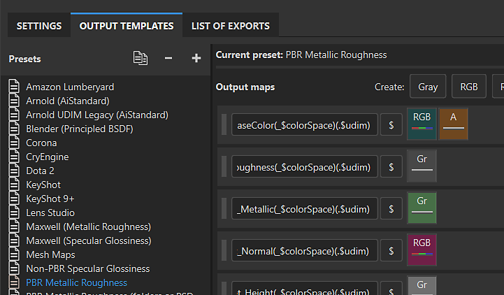

# Modèles de sortie

Substance 3D Painter dispose de deux types de Modèle de sortie qui peuvent être utilisés pour contrôler le comportement du processus d’exportation.

* Les [Modèles de sortie par défaut](default-presets.md) sont conçus pour fonctionner avec des applications ou des workflows 3D spécifiques. Ils sont disponibles dans l&#39;<b>onglet Modèles de sortie</b> de la <b>fenêtre d&#39;exportation</b>. Il est possible de dupliquer et de modifier un modèle par défaut ou de créer votre propre modèle à partir de zéro.
* Impossible de modifier [les Modèles de sortie prédéfinis](../../export/export-presets/predefined-presets/predefined-presets.md). Les modèles prédéfinis apparaissent en haut de la <b>liste déroulante des Modèles de sortie</b> dans l&#39;<b>onglet Paramètres</b> de la <b>fenêtre d&#39;exportation</b>.
