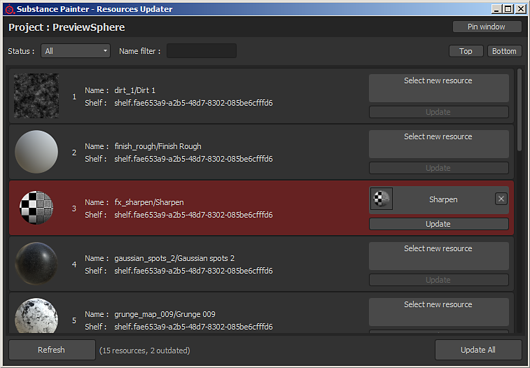

# Outil de mise à jour des ressources

Le plug-in **Resources Updater** permet de parcourir les ressources présentes dans le projet actuellement ouvert.\
Chaque ressource peut être remplacée par une autre présente dans l&#39;étagère. La ressource affichée en rouge est considérée comme « périmée », cela signifie qu&#39;une version différente de la même ressource est présente dans l&#39;étagère et est (probablement) plus récente.
