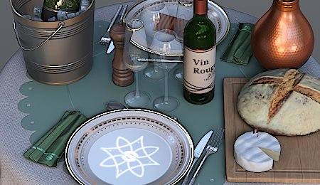

# Accentuer

Améliore les contours et les détails fins de l&#39;image pour augmenter la netteté perçue.

| <b>Paramètre</b> | <b>Description</b> |
| --- | --- |
|  |  |
| --- | --- |
| <b>Quantité</b> | Définit l’intensité de l’effet de netteté. Plus la valeur est élevée, plus le contraste des contours est important. |
| <b>Diamètre</b> | Définit la taille de l’effet de renforcement en pixels. Les valeurs plus faibles accentuent les détails fins ; les valeurs plus élevées affectent les contours plus larges et peuvent créer un effet plus prononcé. |
