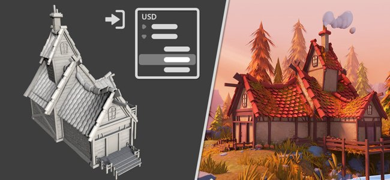

# Universal Scene Description (USD)

Le workflow USD est disponible dans Painter 8.3. [USD](https://graphics.pixar.com/usd/release/intro.html) a été développé par Pixar en tant que format interchangeable convivial qui permet de transporter de nombreux types de données différents.

Dans le cadre de Painter, il est désormais possible de :

* [Créez un projet](../getting-started/project-creation.md) en utilisant les fonctionnalités spécifiques d&#39;USD, telles que le choix de l&#39;étendue et des variantes, les niveaux de subdivision et les cadres d&#39;animation.
* [Exportez](../export/export-window/export-settings.md) des matériaux et des textures au format USD.
* En outre, USD a été ajouté en tant que nouveau format de fichier pour l’exportation en maillage uniquement.
