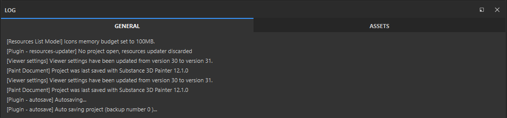

# Journal

Le journal permet à Substance 3D Painter et aux [plug-ins](../../features/plugins/plugins.md) d&#39;afficher les mises à jour d&#39;état, de suivre la progression, les avertissements et les erreurs.

Le journal est divisé en deux onglets.

* L&#39;onglet **Général** affiche des informations relatives à votre projet et à votre scène, y compris des détails d&#39;exportation.
* L&#39;**onglet Actifs** affiche les erreurs et les journaux spécifiquement liés au **panneau Actifs**.
