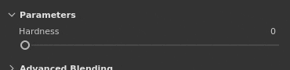

# Curseurs

Cette page explique comment utiliser les curseurs dans l’interface de l’application.

| Action | Exemple | Description |
| --- | --- | --- |
| **Faire Glisser** | 

 | Cliquez et faites glisser lorsque vous survolez un curseur pour modifier sa valeur. |
| **Glissement de précision** | 

 | Maintenez la touche Maj enfoncée tout en cliquant pour augmenter la distance de glissement du curseur. Ce raccourci permet de régler plus précisément le curseur tout en le faisant glisser. |
| **Aller** | 

 | Cliquez n’importe où sur un curseur pour passer à la valeur située sous la position de la souris. |
| **Haut/Bas** | 

 | Après avoir obtenu la mise au point d’un curseur en cliquant dessus, utilisez les touches fléchées Haut et Bas du clavier pour augmenter ou diminuer la valeur étape par étape. |
| **Édition Value** | 

 | Cliquez dans le champ de texte juste au-dessus d’un curseur pour modifier manuellement sa valeur via le clavier. |
