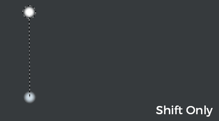

# Ligne droite

La ligne droite est un moyen simple de tracer une ligne avec n’importe quel outil de peinture, en réduisant le nombre de clics et en améliorant la précision.

Il s’agit d’une modification appliquée temporairement à l’aide d’un raccourci clavier.

La position de la ligne droite est calculée à partir du viewport, ce qui signifie que si entre les coups de pinceau, la caméra est déplacée, la ligne droite suivante peut être mal positionnée.

## Activation des lignes droites

Il vous suffit d’appuyer sur la touche Maj lorsqu’un outil de peinture est sélectionné pour afficher les lignes pointillées indiquant la trajectoire que l’outil de peinture doit suivre. Lorsque vous appuyez sur la touche Maj, cliquez n’importe où pour tracer la ligne.

{width="400px"}

## Contraindre une ligne droite

En plus de « Maj », il est possible d&#39;appuyer sur « Ctrl » également pour contraindre la ligne droite tous les 5 degrés.

{width="400px"}
