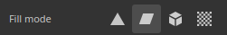
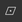
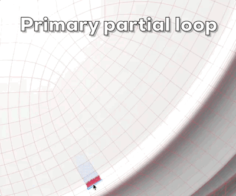

# Remplissage de polygone

L&#39;outil **Remplissage polygonal** remplit les polygones avec des valeurs de couche de matériau ou de masque en niveaux de gris. Il peut être utilisé sur les calques de peinture, les effets et les masques pour remplir rapidement les zones du maillage.

Cet outil est davantage un outil de peinture qu’un outil de sélection : c’est pourquoi, après avoir été utilisé, il ne peut être effacé que via l’outil Gomme ou en le remplissant.

L’outil est accessible à partir de la barre d’outils :

## Paramètres

Vous trouverez ci-dessous la liste des paramètres disponibles avec l&#39;outil **Remplissage polygonal** via la fenêtre **Propriétés**.

### Mode de sélection

Le mode de sélection contrôle la sélection des triangles et des quads de la géométrie du maillage.

| **Mode** | **Description** |
|---|---|
|  **Remplissage rectangulaire** | Dessinez une sélection rectangulaire en cliquant et en faisant glisser. Le **mode de remplissage** définit la géométrie à remplir, tandis que le **test de frappe** définit les polygones inclus.    |
|  **Remplissage en boucle polygone** | Remplissez une boucle complète de quads d&#39;un simple clic. Le déplacement permet de sélectionner plusieurs boucles.    |
|  **Remplissage partiel en boucle de polygone** | Remplissez une partie d’une boucle en cliquant et en faisant glisser. La sélection peut s’étendre le long de boucles secondaires pour former une plaque de polygones.    |

### Mode de remplissage

Le mode de remplissage, qui ne peut être utilisé qu&#39;avec le mode **Remplissage rectangulaire**, contrôle les parties de la géométrie qui sont sélectionnées.

| **Mode** | **Description** |
|---|---|
|  **Remplissage triangulaire** | Remplissez des triangles de maillage individuels. |
|  **Remplissage polygonal** | Remplissez des polygones entiers. Sur un maillage triangulé avant l&#39;importation, le résultat est identique au **remplissage triangulaire**. |
|  **Remplissage Maillage** | Remplissez chaque polygone connecté à celui sur lequel vous avez cliqué. |
|  **Remplissage UV** | Polygones de remplissage connectés dans l’espace UV. Le remplissage s’arrête aux bordures UV. |

### Test d’impact

Les paramètres de test de frappe contrôlent la sélection des triangles et des quads selon le mode **Remplissage rectangulaire**.

| **Mode** | **Description** |
|---|---|
|  **Intersection** | (par défaut) Un polygone est rempli si une partie de sa géométrie se trouve à l’intérieur ou coupe la zone de sélection. |
|  **Centre contenu** | Un polygone est rempli uniquement si son point central se trouve à l’intérieur de la zone de sélection. |
| **Polygones visibles uniquement** | Si cette option est activée, le remplissage n&#39;affecte que les polygones visibles depuis la vue de caméra courante. Les polygones occlus et tournés vers l’arrière sont ignorés. Si cette option est désactivée, les polygones peuvent être remplis à travers le maillage. |

### Fusion

Ces paramètres contrôlent la façon dont le résultat du remplissage est mélangé aux pixels sous-jacents.

| **Paramètre** | **Description** |
|---|---|
| Mode de fusion | Contrôlez la façon dont le remplissage est fusionné avec les valeurs de pixels existantes. En mode **Matériau**, le mode de fusion s&#39;applique à tous les canaux activés dans la section **Matériau**. |
| Opacité | Contrôlez l’opacité du remplissage. |

>[!NOTE]
>
> L’outil prend en charge les mêmes modes de fusion que ceux disponibles dans la pile de calques. Pour plus d&#39;informations, consultez la [page de documentation sur les modes de fusion](https://experienceleague.adobe.com/fr/docs/substance-3d-painter/using/interface/layer-stack/blending-modes).

### Matériau

La section matériau contrôle les canaux sur lesquels l’outil peut activer la peinture.

## Raccourcis

L’outil Remplissage polygonal peut être utilisé efficacement à l’aide de raccourcis clavier spécifiques :

| **Raccourci** | **Description** |
|---|---|
| **Alt** | Avec le **remplissage de boucle de polygone** et le **remplissage de boucle de polygone partiel**, ce raccourci étend la sélection de l&#39;autre côté du clic initial tout en faisant glisser.    |
| **Maj** | Avec le **Remplissage partiel de boucle de polygone**, ce raccourci ne remplit que la boucle principale, en ignorant les boucles secondaires. Exemple d&#39;activation/désactivation de **Maj** :    |
| **Maj + A** | Ce raccourci bascule temporairement vers le **remplissage en boucle de polygone** à partir de tout autre mode de sélection. Si le raccourci est relâché avant le bouton de la souris, la sélection continue jusqu’à ce que le bouton de la souris soit relâché. |
| **A** | Si vous appuyez sur ce raccourci tout en le faisant glisser, le résultat obtenu est combiné au résultat précédent. Cela fonctionne entre les modes de fusion et les opacités :    |

## Restrictions

Certaines limitations s’appliquent à l’outil :

* Le **remplissage en boucle de polygone** et le **remplissage en boucle de polygone partiel** fonctionnent uniquement sur les quads, de sorte que les triangles et les n-gons ne peuvent pas être remplis avec ces modes.
* La prise en charge de la **symétrie radiale** est également limitée et peut ne pas être fiable. Pour utiliser la symétrie, préférez le mode miroir. Consultez la [page de documentation de la symétrie](https://experienceleague.adobe.com/fr/docs/substance-3d-painter/using/painting/symmetry/symmetry) pour plus d&#39;informations.
* L&#39;outil remplit la géométrie du **Jeu de textures actif** uniquement. La structure filaire est affichée pour ce Jeu de textures et est mise à jour lorsque le Jeu de textures actif change.
