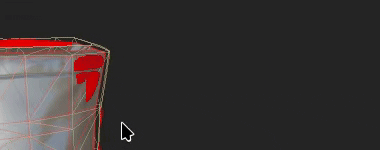
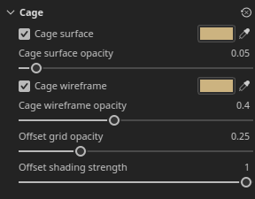
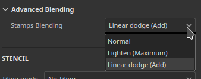

# Version 12.2

**Substance 3D Painter 12.2** offre un outil de remplissage polygonal amélioré avec une sélection en boucle, la peinture à la cage pour le baking, la mise en surbrillance des Jeux de textures dans le viewport et une transparence indépendante de l&#39;ordre pour le rendu en temps réel.

Date de publication : **21 octobre 2026**

## Principales fonctionnalités

### Remplissage polygonal amélioré

L&#39;outil **Remplissage polygonal** a été remanié avec une nouvelle interface et de nouveaux modes de sélection pour les boucles polygonales. L’outil prend désormais également en charge les modes de fusion avec un contrôle d’opacité et peut travailler sur plusieurs couches à la fois. L’occlusion des poignées de sélection est également ignorée, ce qui signifie que les polygones masqués de la caméra sont ignorés.

* **Interface améliorée**

  Les paramètres de **remplissage polygonal** de la fenêtre **Propriétés** ont été remaniés pour être plus faciles à utiliser. Les options s’affichent désormais sous forme de rangées de boutons, ce qui accélère le basculement entre les modes. Les nouvelles icônes d’info-bulle décrivent le fonctionnement de chaque mode.

  

* **Nouveaux modes de sélection**

  Deux nouveaux modes dédiés aux boucles de polygone ont été ajoutés à la ligne **Mode de sélection** :

  

  * **Remplissage de boucle polygonale** : ce mode remplit une boucle complète de quads en un seul clic. Maintenir la touche **Alt** enfoncée tout en faisant glisser étend également la sélection dans la direction opposée.

    

  * **Remplissage partiel de boucle de polygone** : ce mode ne remplit qu’une partie d’une boucle, et faire glisser le pointeur le long de la boucle étend la sélection. Lors du déplacement, des flèches indiquent le flux de topologie de chaque côté de la sélection afin d’anticiper les changements de chemin inattendus. Une info-bulle en regard du curseur indique le nombre de polygones sélectionnés sur les deux axes. Maintenir la touche **Alt** enfoncée tout en faisant glisser étend également la sélection dans la direction opposée.

    

  Maintenir **Maj + A** enfoncé permet également de passer temporairement à **Remplissage en boucle de polygone** à partir de n&#39;importe quel mode de sélection. Si le raccourci est relâché avant le bouton de la souris, la sélection continue jusqu’à ce que le bouton de la souris soit relâché.

* **Le mode Fond modifie le mode de sélection**

  Les options du **mode de remplissage** ne s&#39;appliquent pas aux modes de **remplissage en boucle de polygone** et de **remplissage en boucle de polygone partiel**. Pour cette raison, la sélection d&#39;un mode de remplissage rétablit automatiquement le **mode de sélection** sur le mode principal.

  

* **Nouvelle option de test effectif**

  La nouvelle option **Hit-test** contrôle les polygones inclus dans la zone de sélection. Le rejet des polygones non visibles est désormais le comportement par défaut, car l&#39;option **Polygones visibles uniquement** est activée par défaut. La désactivation de cette option rétablit le comportement précédent de remplissage par le maillage.

  Les options disponibles sont les suivantes :

  * **Intersection** : (par défaut) un polygone est rempli si une partie de celui-ci se trouve à l&#39;intérieur de la zone de sélection ou croise son bord.
  * **Centre contenu** : un polygone est rempli uniquement si son point central se trouve à l&#39;intérieur de la zone de sélection.
  * **Polygones visibles uniquement** : si cette option est activée, elle ne remplit que les polygones visibles dans la vue de caméra courante. La géométrie occultée et tournée vers l&#39;arrière est donc ignorée.

  

* **Modes de fusion et opacité**

  L&#39;outil **Remplissage polygonal** prend désormais en charge tous les modes de fusion, la même liste que celle disponible dans la pile de calques. Par exemple, **Linear dodge (Add)** ajoute des valeurs aux valeurs existantes au lieu de les remplacer. Les modes sont disponibles dans la nouvelle section **Fusion** de la fenêtre **Propriétés** en plus d&#39;un curseur **Opacité**. En mode **Matériau**, le mode de fusion s&#39;applique à tous les canaux activés dans la section **Matériau**.

  

* **Remplir plusieurs canaux à la fois**

  L&#39;outil **Remplissage polygonal** n&#39;est plus limité à un canal unique. Toutes les propriétés de canal activées dans la section **Matériau** peuvent désormais être définies et remplies en une seule action.

  

* **Compatible avec symétrie**

  Le **remplissage en boucle de polygone** et le **remplissage en boucle de polygone partiel** fonctionnent également avec la symétrie. Un simple clic fonctionne avec la symétrie en miroir (la symétrie radiale peut être moins fiable, cependant).

  

* **Reprendre le trait précédent**

  Le raccourci **Reprendre le trait précédent** (en maintenant le **A** enfoncé) fonctionne désormais avec l&#39;outil **Remplissage polygonal**, y compris entre les modes de fusion et les opacités.

  

* **Commentaires plus clairs entre les Jeux de textures**

  La structure filaire s’affiche désormais pour le Jeu de textures actif uniquement et est mise à jour lorsque la sélection change. Le survol de la géométrie à partir d&#39;un autre Jeu de textures affiche désormais un curseur interdit pour indiquer que la géométrie associée ne peut pas être remplie.

  

>[!NOTE]
>
> Pour plus d&#39;informations sur l&#39;outil **Remplissage polygonal**, consultez la [page de documentation dédiée](https://experienceleague.adobe.com/fr/docs/substance-3d-painter/using/painting/paint-tools/polygon-fill).

### Nouvelle peinture à la cage en mode Baking

Le nouveau **mode de peinture à la cage** est un décalage de cage par pixel qui peut être peint par-dessus le décalage de distance global. Cela signifie que la cage peut désormais être ajustée en peignant directement sur le maillage. Les zones où le maillage high poly sort de la cage peuvent alors être fixées localement plus facilement.

* **Nouvelle peinture du décalage de la cage**

  Un nouveau bouton **cage de Peinture** en mode Baking passe désormais en mode cage. Dans ce mode, les outils **Peinture**, **Gomme** et **Remplissage polygonal** peuvent être utilisés pour ajuster la distance entre la cage et le maillage low poly.

  

  Pour ce faire, peignez une texture intermédiaire. Cette texture est ensuite utilisée comme décalage sur le maillage de cage lors du baking. Cela est similaire au processus de **peinture inclinée**.

  Un paramètre de **Force** dans la barre d&#39;outils supérieure définit la valeur de décalage appliquée par le contour. Les commandes habituelles de **taille**, de **flux**, d&#39;**opacité du trait** et d&#39;**Espacement** sont également disponibles, ainsi qu&#39;un bouton **Inverser la valeur**. Symétrie également prise en charge.

  

  

* **Utiliser le remplissage polygonal pour sélectionner et remplir des parties entières du maillage**

  L&#39;outil **Remplissage polygonal** peut ajuster la distance de cage de sous-objets partiels ou complets à la fois. Cliquer sur un élément ouvre une barre d&#39;outils flottante avec un curseur de **Force de Cage**. Ce curseur agrandit ou rétrécit la cage en temps réel, à partir de la valeur définie dans la barre d’outils supérieure. Les décalages peints sont ensuite ajoutés au-dessus du décalage.

  

* **Afficher les décalages de cage dans le viewport**

  L’activation du mode cage fait passer le viewport dans un nouveau mode d’affichage. Dans ce mode, les décalages sont visibles sous la forme d’une incrustation verte sur la cage. La cage est également déformée pour représenter le maillage de cage utilisé pendant le processus de baking.

  

  Quelques paramètres peuvent être contrôlés via le panneau **Visualisation du Baking** : la section **Cage** contrôle les affichages de **surface de Cage** et de **structure filaire de Cage**, ainsi que leur opacité. Il a également une **opacité de grille de décalage** et une **force d&#39;ombrage de décalage**.

  

* **Mode de fusion dans la barre d&#39;outils contextuelle**

  Quelques modes de fusion sont disponibles directement dans la barre d’outils contextuelle pour plus de commodité. Ils permettent de régler plus facilement le décalage de la cage, notamment pour ajouter ou soustraire des décalages.

  Les modes disponibles sont les suivants :

  * **Normal** : remplace le décalage existant par la valeur de contour.
  * **Lighten (max.)** : conserve la valeur la plus élevée du contour et le décalage existant.
  * **Linear dodge (Ajouter)** : (par défaut) ajoute la valeur de contour au décalage existant.

  

  D&#39;autres modes de fusion sont disponibles avec le **Remplissage polygonal** à l&#39;aide du menu contextuel dans le viewport.

* **Nouveau menu de réinitialisation pour la cage et la peinture inclinée**

  Les modes de peinture en cage et en biais disposent désormais tous deux d’un nouveau menu pour réinitialiser les paramètres. Les options disponibles sont :

  * **Réinitialiser les paramètres de cage/inclinaison** : réinitialisez les paramètres de l&#39;interface utilisateur à leurs valeurs par défaut.
  * **Effacer tous les traits de cage/peinture inclinée** : effacez la texture utilisée pour la cage ou la peinture inclinée.
  * **Réinitialiser et effacer tout** : combinez à la fois la réinitialisation de l&#39;interface utilisateur et l&#39;effacement des textures de cage/inclinaison.

  

>[!NOTE]
>
> Pour plus d&#39;informations sur le baking, consultez la [page de documentation dédiée](https://experienceleague.adobe.com/fr/docs/substance-3d-painter/using/baking/baking).

### Mise en surbrillance du nouveau Jeu de textures dans le viewport

Le nouveau comportement de mise en surbrillance peut désormais aider à identifier les géométries du viewport 3D associées à un **Jeu de textures** ou à une **Tuile UV**.

* **Mise en surbrillance dans la liste par Jeu de textures**

  Le survol d&#39;une entrée dans la **liste de Jeux de textures** met désormais en évidence sa géométrie dans le viewport, pour les Jeux de textures et les Tuiles UV. Cela permet de voir facilement quelle partie du maillage appartient à chaque Jeu de textures.

  

* **Mise en surbrillance par viewport**

  Maintenez la touche **Ctrl/Cmd + Alt** enfoncée sur le modèle pour mettre en surbrillance la géométrie du Jeu de textures sous le curseur. La mise en surbrillance est masquée lorsque vous appuyez sur le bouton gauche de la souris ou lorsque vous effectuez un panoramique, et revient une fois les modificateurs relâchés.

* **Disponible en modes Peinture et Baking**

  La surbrillance fonctionne à la fois en mode peinture et en mode baking. En mode baking, les Jeux de textures désactivés sont affichés en gris lorsqu’ils sont mis en surbrillance.

### Nouvelle transparence indépendante de l’ordre

Le viewport en temps réel prend désormais en charge la transparence indépendante de l’ordre. Elle supprime les artefacts de tri et le scintillement qui peuvent apparaître lorsque plusieurs surfaces transparentes ou translucides se chevauchent.

* **Nouvelle option dans les paramètres d&#39;affichage**

  L&#39;option **Transparence indépendante de la commande** peut être activée dans la section **Paramètres de rendu** des **Paramètres d&#39;affichage**. Elle est désactivée par défaut pour éviter d’affecter les performances.

  

  Avant et après l’activation du nouveau paramètre :

  

* **Contrôle des performances**

  Un paramètre de **capacité de tri** contrôle le nombre moyen de calques de transparence pouvant être triés par pixel. Des valeurs élevées améliorent la qualité de transparence dans les scènes complexes, mais elles peuvent utiliser davantage de mémoire et réduire les performances. Les options disponibles sont les suivantes :

  * **Faible (1x)**.
  * **Moyenne (2x)**.
  * **Élevé (4x)** (par défaut)
  * **Très haut (8x)**
  * **Ultra (16x)**

### Améliorations diverses

Des fonctionnalités et améliorations supplémentaires ont été ajoutées dans cette version :

* **Paramètres D&#39;Affichage Réorganisés**

  Les paramètres de la fenêtre **Paramètres d&#39;affichage** ont été regroupés et réorganisés, ce qui facilite la navigation dans le panneau. Les paramètres sont désormais divisés en **paramètres d&#39;environnement**, **paramètres de Caméra**, **Effets de post-traitement**, **paramètres de rendu** et **paramètres de visualisation**. Une rangée de boutons en haut de la fenêtre permet de passer directement à chaque groupe.

  

* **Fusion additive avec coups de pinceau**

  Les paramètres de pinceau offrent désormais un nouveau mode de fusion additif. Dans ce mode, les contours s’additionnent dans le même calque, au lieu de se remplacer. Cela ne se limite pas aux tampons à l’intérieur d’un trait. Avec ce nouveau mode, vous pouvez ajouter de la couleur ou sculpter la couche height en ajoutant ou en supprimant des valeurs.

  

* **Nouveau mappage de moteur de voisinage UV**

  Une nouvelle entrée de mappage de moteur `mesh_uv_neighbor` est disponible pour les matériaux de Substance de données et les filtres. Il fonctionne comme une texture d&#39;UV advection pour trouver l&#39;autre face d&#39;un seam d&#39;Îlot UV. Ses couches rouge et verte stockent l’UV utilisée pour atteindre le pixel voisin à travers un UV.

  Pour plus d&#39;informations sur ces textures de moteur, consultez la [page de documentation dédiée](https://experienceleague.adobe.com/fr/docs/substance-3d-painter/using/content/creating-custom-effects/mesh-based-input).

## Notes de mise à jour

### 12.2.0

Date de publication : **2026/10/21**

Résumé : **Cette mise à jour est une version majeure. Elle ajoute une nouvelle fonctionnalité de peinture sur Cage pour le baking et apporte des améliorations à la fonctionnalité de remplissage de polygone. Pour plus de détails, consultez les notes de mise à jour complètes.**

**Ajouté :**

* Baking, Cage
* &amp;lbrack ; Cage Painting&amp;rbrack ; Create basic Cage Peinture UI
* &amp;lbrack ; Cage Painting&amp;rbrack ; Nouvelles options de visualisation des cages
* &amp;lbrack ; Cage Painting&amp;rbrack ; Outil de sélection/remplissage modifiable
* &amp;lbrack ; Cage Painting&amp;rbrack ; Afficher le mode Fusion dans la barre d&#39;outils
* &amp;lbrack ; Cage Painting&amp;rbrack ; HDR slider UI Changes
* &amp;lbrack ; Cage de peinture&amp;rbrack ; shader de visualisation
* &amp;lbrack ; Cage Painting&amp;rbrack ; Réinitialiser les options de Pile
* Améliorations de l’outil Remplissage polygonal
* &amp;lbrack ; Polygon Fill&amp;rbrack ; Add polygon patch
* &amp;lbrack ; Polygon Fill&amp;rbrack ; Add polygon loop
* &amp;lbrack ; Prise en charge des Symétries de remplissage et de brack ; polygonales avec boucle/patch
* &amp;lbrack ; Polygon Fill&amp;rbrack ; Symétrie de l&#39;aperçu du bord
* &amp;lbrack ; Polygon Fill&amp;rbrack ; Remove Triangles with Loops and Partial Loops
* &amp;lbrack ; Polygon Fill&amp;rbrack ; Structure filaire visible uniquement pour le Jeu de textures actif
* &amp;lbrack ; Polygon fill&amp;rbrack ; Red edge highlight on non-clickable triangles
* &amp;lbrack ; Polygon fill&amp;rbrack ; Don&#39;t disable the fill mode options
* &amp;lbrack ; Polygon Fill&amp;rbrack ; Permet de définir toutes les propriétés de canal avec le remplissage polygonal
* &amp;lbrack ; Polygon Fill&amp;rbrack ; Reprendre le contour précédent fonctionne avec le remplissage Polygone
* &amp;lbrack ; Polygon fill&amp;rbrack ; Show forbidden cursor on non-active Jeux de textures
* &amp;lbrack ; Polygon Fill&amp;rbrack ; ALT aperçu instantané
* &amp;lbrack ; Polygon Fill&amp;rbrack ; Raccourci pour le passage temporaire à Polyloop (SHIFT+A)
* &amp;lbrack ; Viewport&amp;rbrack ; Afficher la sélection du Jeu de textures/de la Tuile UV en surbrillance
* &amp;lbrack ; Viewport&amp;rbrack ; Ajout de la prise en charge de la transparence indépendante de l&#39;ordre dans le viewport en temps réel
* &amp;lbrack ; Paramètres d&#39;affichage&amp;rbrack ; Réorganiser les paramètres d&#39;affichage en nouveaux groupes
* &amp;lbrack ; Tool&amp;rbrack ; Add support for additive blending with brush strokes
* &amp;lbrack ; Tool&amp;rbrack ; Add support for additive blending with Polygon Fill
* &amp;lbrack ; USD&amp;rbrack ; USD exporté avec map opacity rend tout transparent dans Arnold
* &amp;lbrack ;Nvidia&amp;rbrack ; Ajouter un avertissement concernant les derniers pilotes Nvidia (616.56 à 617.14)
* Ajouter une nouvelle entrée de mappage de moteur « maillage_uv_neighbor »
* Mettre à jour les bakers vers la version 3.23.0
* Mettre à jour le moteur de Substance vers la version 9.6.1

**Fixe :**

* &amp;lbrack ; Baking&amp;rbrack ; Ambient occlusion Ignorer l&#39;arrière-plan par nom de maillage ne fonctionne pas
* &amp;lbrack ; Baking&amp;rbrack ; &amp;lbrack ; AMD&amp;rbrack ; Périphérique perdu lors du baking avec de lourds maillages poly élevés
* &amp;lbrack ; Performances&amp;rbrack ; Painter ralentit l&#39;utilisation de VRAM
* &amp;lbrack ; Viewport&amp;rbrack ; textures manquantes lors de l’ouverture de projets sur des écrans HDPI
* &amp;brack ; Tool&amp;rbrack ; Le mode de fusion est grisé lorsque vous peignez dans un masque
* Dossiers temporaires non supprimés après l’exportation sur le réseau
* &amp;lbrack ; USD&amp;rbrack ; La géométrie USD exportée est divisée le long des bordures UV
* &amp;lbrack ; USD&amp;rbrack ; se bloque lors du chargement de USDz mal formés
