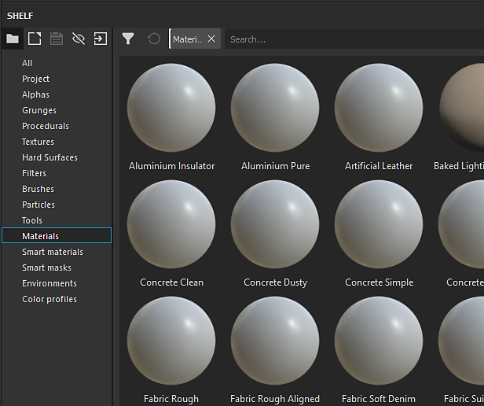
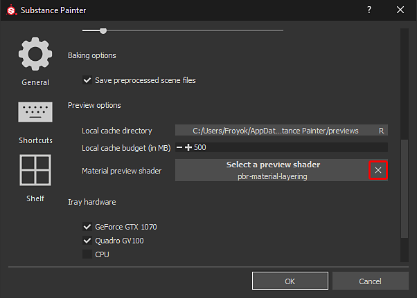

# Les vignettes de l’étagère semblent incorrectes

Si les vignettes de l’étagère semblent être différentes de la normale, cela peut être dû au shader utilisé pour le rendu des prévisualisations.

| Vignettes rompues | Vignettes normales |
| --- | --- |
| 

 | 

 |

## 1 - Ouvrir la fenêtre principale des paramètres

Accédez à **Modifier** et cliquez sur **Paramètres** :

## 2 - Supprimer le shader d’aperçu de l’Étagère

Dans la vue **Général**, faites défiler vers le bas jusqu&#39;à ce que la section « Options de prévisualisation » soit visible.\
Cliquez sur le bouton **croix** devant le « **Shader d&#39;aperçu de matériau** » pour supprimer le shader actuellement spécifié.

{width="450px"}

## 3 - Redémarrez Substance 3D Painter

Pour régénérer les vignettes afin qu’elles aient l’aspect correct, Substance 3D Painter doit être redémarré.
