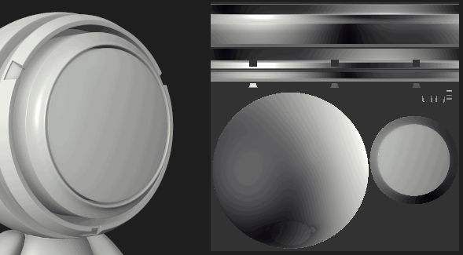

# Fonds perdus de l’outil peinture sur d’autres Îlots UV

Certains comportements par défaut de l&#39;[outil Peinture](../../../features/effects/paint.md) peuvent sembler contre-intuitifs dans certaines situations spécifiques. Substance 3D Painter est une application qui fonctionne principalement dans l’espace 3D, cela s’applique également à la peinture. Le paramètre par défaut du pinceau de peinture est de s’efforcer d’être fluide entre les UV lors de la peinture. C’est pourquoi, lorsque vous interagissez avec la Vue 2D, certains résultats peuvent sembler inattendus.

Pour éviter le débordement sur les autres Îlots UV lorsque vous peignez dans la Vue 2D, modifiez simplement le paramètre **Alignement** dans les paramètres de l&#39;outil :

| *Mode d&#39;alignement* | *Aperçu* |
| --- | --- |
| **Retour à la ligne automatique** | 

 |
| **UV** | 

 |
